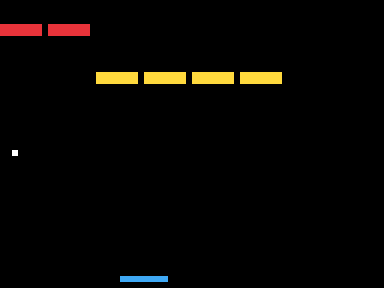
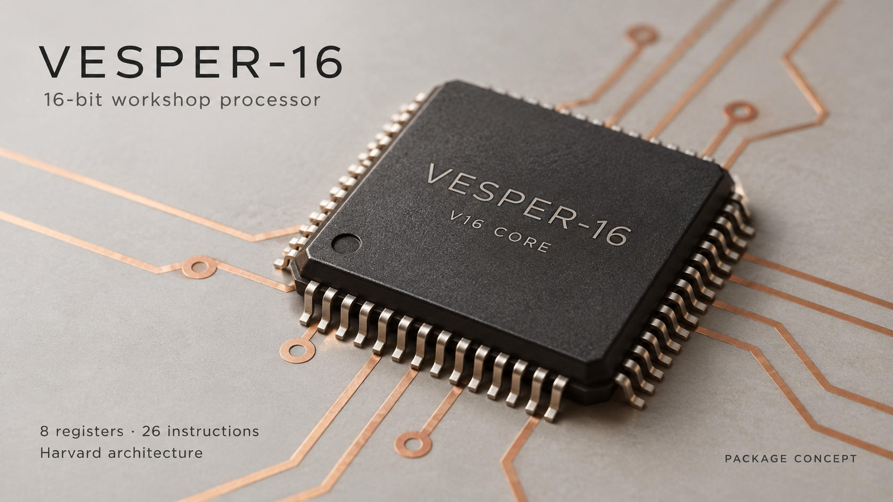
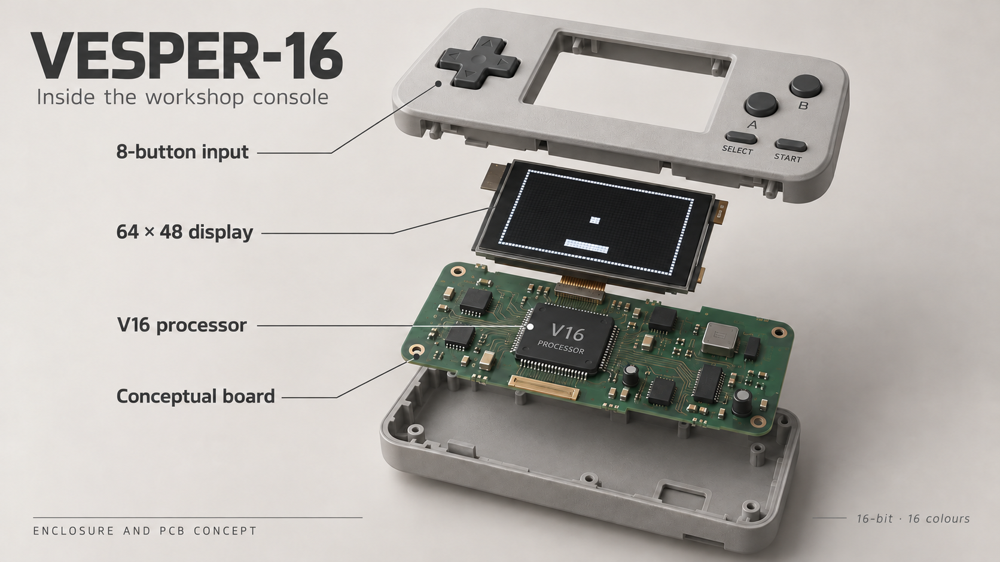

# VESPER-16 development kit

Write the game described in [tasks/T3.md](tasks/T3.md) for the VESPER-16 handheld console.
The kit contains the console's assembler + emulator and two tiny example programs.
There is no manual — working out how the console behaves is part of the exercise.

<p align="center"></p>
<p align="center"><sub>What a finished T3 looks like (12 s from a real solution, frames 600–960, scaled 6×):
the paddle returns the ball and the green score bar grows; a miss resets the score and relaunches the ball.</sub></p>

**Bonus:** [tasks/T4.md](tasks/T4.md) is a second game, Breakout, for anyone who finishes early or wants
to try a skill on a game it was not written for.

<p align="center"></p>
<p align="center"><sub>What a finished T4 looks like (12 s from a real solution, frames 600–960, scaled 6×):
the last bricks break, the full wall comes back and the ball rests on the paddle until A is pressed.</sub></p>

## Design concepts

These illustrations show a possible physical design for the VESPER-16 processor and handheld
console. They are design concepts; the development kit runs the machine in an emulator.



*Processor package concept.*



*Exploded handheld console concept, showing the display, controls, board and V16 processor.*

## Requirements

- **Linux x86-64** (`bin/vesper`) or **Windows x64** (`bin/vesper.exe`). Both are self-contained
  executables and behave identically. macOS: use a Linux VM or container.
- A web browser for the frame viewer (`player.html`).
- Python 3.9+ and git — for `workshop.py` (the grader also needs numpy: `pip install numpy`).

## Start

Linux:
```sh
git clone https://github.com/dkreinov/VESPER-16.git
cd VESPER-16
chmod +x bin/vesper
bin/vesper run examples/fill.vsa --frames 30 --out out/fill
```

Windows (PowerShell):
```powershell
git clone https://github.com/dkreinov/VESPER-16.git
cd VESPER-16
.\bin\vesper.exe run examples\fill.vsa --frames 30 --out out\fill
```

Both print `OK 30 frames` and write `out/fill/frame_0000.png …`. Open `player.html` in a browser
and drop the output folder (or a `--gif` file) onto it to watch the frames.

Where the task files write `bin/vesper`, Windows users run `.\bin\vesper.exe`.
Save your program as `solutions/T3.vsa` (bonus: `solutions/T4.vsa`).

## Workshop

`workshop.py` runs the exercise in three stages and measures each one: agent time, emulator runs,
tokens, estimated API cost and score.

```sh
python workshop.py new s1                 # stage 1: checks this computer (doctor), then a clean folder + the prompt
python workshop.py done                   # the agent is done: measure and save (grade)
python workshop.py skill                  # stage 2: the prompt that asks the SAME agent to write a skill
python workshop.py harvest                # stage 2 is done: take the skill out and check it
python workshop.py new s3 --task all      # stage 3, four runs (T3 and T6, each with and without the skill): the default way
python workshop.py new s3 --task both     # stage 3, two runs (T6, then T3)
python workshop.py new s3 --task T6       # alternative: stage 3, run 1: T6 with YOUR name (it asks), a NEW agent thread
python workshop.py new s3 --task T3       # stage 3, run 2: T3 again, a SECOND new agent thread (same time)
python workshop.py done <run_id>          # end one stage-3 run (plain `done` asks which one)
python workshop.py unlock 4 <password>    # the grader - only after your agents are done
python workshop.py grade                  # scores the stages that are not graded yet
python workshop.py show                   # your table and the active runs
python workshop.py submit                 # LAST STEP: grades if needed, then sends all results in ONE form window
python workshop.py form                   # open the form again for one stage (last stage; or: form <run_id> <stage>)
python workshop.py cleanup                # removes everything workshop.py made
python workshop.py doctor                 # the setup check alone (new s1 runs it for you)
```

Open each run folder that `new` prints as its own project in your agent (Codex, Claude Code or Cursor),
in a new thread, and paste the prompt. Stage 2 uses the same thread as stage 1.
Codex: if Memories are on, type /memories first in each new workshop thread and turn memory off for that chat.

**Stage 3 runs four agents at the same time.** `new s3 --task all` (the default way; `--name` works with it)
makes four runs in one command: (1) T3 WITH your skill, (2) T3 WITHOUT the skill (the control: same model, same
task, no skill in the folder, and a prompt without the skill sentences),
(3) T6 WITH your skill (a different task that shares components with T3), and (4) T6 WITHOUT the skill (control, same name on the
nameplate). Stop EVERY one of the four at 10 min (the same time box for all arms), then run its `done` line. Runs 2 and 4 make the matched comparison: what the skill adds in one attempt; `show` compares each pair, marks each score
PASS or FAIL, and prints the observed score gains on T3 and T6. These results neither identify nor rule out answer
reuse, and reliability is unknown (one attempt per condition). The tool prints the order to start the four threads
(random per stage-1 run) and shows the runs in that order. At the end of each run it prints an isolation check: a scan
of the agent's tool calls for reads of other run folders, the kit folder and memory files. The scan finds some outside
reads; it is not proof. A run whose agent kept working more than 10 minutes after its prompt (the time in the agent log; the time you
run `done` does not count) is flagged as an overrun. `show` marks its score with `!` ("! = over 10 min"), the compare prints "over 10 min" next to it,
and neither calls that pair a matched comparison. If a run is stopped at the box with the grader still locked, it is
saved as "ungraded + stopped"; `grade` scores it later as partial work. `--task both` (T6 and T3 with the skill) still works. You can start the runs one by one instead:
`new s3 --task T6` asks for your name (up to 8 letters A-Z) and
writes it into `tasks/T6.md`; T6 is a different task that shares components with T3. `new s3 --task T3` repeats the
stage-1 game. Open each folder in its own new thread and choose the small model there (Claude Code: Haiku 5.5, `/model claude-haiku-5-5`;
Codex: gpt-6-luna; Cursor: GPT-5.6 Luna High, not Auto). The prompt gives a budget of 6 emulator runs; the time box is
10 minutes (by hand the tool records the time but does not stop the agent: you stop it; `--auto` stops it for you). End each run with the `done <run_id>`
command that `new` printed.

**When `doctor` finds a fault** it writes `doctor-report.txt` into this folder and prints a short prompt.
Paste that prompt into any LLM (an agent opened in this folder can read the file; in a chat, attach the file).

**What workshop.py does:** copies the kit into run folders under `%LOCALAPPDATA%\vesper-runs`
(Windows) or `~/vesper-runs`, runs `git init` there, runs the emulator and the grader, reads your agent's
local session logs to count tokens (it finds them by the `Workshop run:` line in the prompt). At the end,
`submit` opens the results form in your browser.
**What it does not do:** it never starts an agent unless you run `--auto` or `shadow`, and both ask
first (you paste every other prompt yourself), it sends nothing over the network, and it changes nothing
outside its own folder unless you confirm.

- The prompts are plain files in `prompts/`; read them before you paste them.
- Cost is an estimate at API list prices (table at the top of `measure.py`); subscription users do not pay
  per token. For Cursor, type the numbers from Cursor's usage screen when `done` asks.
- **Results form:** https://forms.cloud.microsoft/r/xdtPcwF24a (Mobileye sign-in). `done`, `harvest` and
  `grade` only save the numbers. At the end run `python workshop.py submit`: it grades any ungraded result first
  (the grader must be unlocked), then opens ONE browser window with the form and your alias filled in, and
  copies all your results to the clipboard. Click the `all_results` field, press Ctrl+V (Cmd+V on a Mac),
  click Submit, and press Enter. If the paste is empty, copy the printed lines by hand.
  The form has only two fields, `alias` and `all_results` (one `vesper-results v1` line per run).
- If `doctor` shows RED, follow [MANUAL.md](MANUAL.md). More exercises: [HOMEWORK.md](HOMEWORK.md).
- **Take home:** [HOW-TO-TEST-A-SKILL.md](HOW-TO-TEST-A-SKILL.md): how to choose, build and test a skill in your own work.

### Stage 3 with `--auto`

`python workshop.py new s3 --task all --auto` makes the same four run folders, with the same prompts and the same start
order. Then the tool starts the four agents itself, one after the other, without a window. Each agent works in its own
run folder with the stage-3 model of your agent (Codex: gpt-6-luna, effort high, Memories off; Claude Code: claude-haiku-5-5, only
the project settings; Cursor: gpt-5.6-luna-high). `--model NAME` changes the model. The tool prints one short status
block every 30 seconds, stops any agent still working at 10 minutes (the whole process tree), and finishes each run
like `done <run_id>`. The row says `settings_confirmed = auto` and, for a run that the tool stopped, `stopped = time`.
Ctrl+C stops all agents (Windows: each agent is in a Job Object, so every process it started dies too) and saves each
stopped run as partial work (`stopped = ctrl-c`). The manual flow (without `--auto`) does not change.

- **Before the start:** the tool says what the agents may do, and asks `Start the 4 agents? [y/N]` (default No).
  Without a terminal it starts only with `--yes`. The flags ask for these limits: Codex `-s workspace-write`;
  Claude Code `--permission-mode dontAsk` (it may run `bin/vesper`, `ls`, `cat`, `head`, `mkdir out`, and read,
  edit and write files in its run folder); Cursor never gets `--force`: each Cursor run folder has
  `.cursor/cli.json` (allow `bin/vesper`, read and write inside the folder), plus `--sandbox enabled` on macOS/Linux
  (the sandbox does not exist on Windows). The tool says a limit is verified only after
  `doctor --check-auto` passed on this computer (otherwise: "Not verified on this computer"). The agents can read
  other folders on this disk; the isolation check looks for that. The prompt goes on stdin (Codex, Claude Code), so a
  `.cmd` launcher (npm) gets every flag.
- **Failed run:** an agent that ends within 60 seconds, or with an error and no tool call, or with a known error
  (no login, free plan) gives no data. The row says `stopped = error` with the first error line in `error_note`, the
  run is not graded and stays open: do it by hand with `python workshop.py new s3 --task all` (it shows its page).
- **Resume:** `new s3 --task all --auto` again starts only runs that `--auto` made, that are not done, and that no
  live agent holds (`.agent.lock` in the run folder). It never starts a run whose page you saw (manual).
- **Check first:** `python workshop.py doctor` says whether `--auto` is ready for your agent (CLI found, Cursor logged
  in). `python workshop.py doctor --check-auto` makes ONE tiny run with the stage-3 model and the real `--auto` flags:
  the agent writes `out/ok.txt`, runs `bin/vesper --version` and tries to write a file outside its folder. It prints
  PASS only if `out/ok.txt` exists and the outside file does not.
- **Codex:** `--auto` uses `codex.exe` of the Codex app (`%LOCALAPPDATA%\OpenAI\Codex\bin\<hash>\codex.exe`). The
  npm `codex` is used only if it is version 0.163 or newer (0.154 rejects gpt-6-luna on a ChatGPT account).
- **Cursor, install and login (Windows PowerShell):** `irm 'https://cursor.com/install?win32=true' | iex`, then
  `agent login` (it opens the browser). macOS/Linux: `curl https://cursor.com/install -fsS | bash`, then `agent login`.
  Cursor keeps no token counts on disk, so the tool saves the output of the run in `agent-output.jsonl` in the run
  folder and measures from it.
- **Cursor free plan:** a free plan lists the models but runs only Auto. A run with a named model then fails with
  "Named models unavailable". `doctor --check-auto` reports "free plan: only Auto". Use the manual flow, or a paid plan.
- **Cursor rules:** Cursor loads your User Rules and alwaysApply rules in every run. Turn them off for a clean run.
- **Lost window:** each stage-3 prompt is also saved as `PROMPT.txt` in its run folder. If you press Ctrl+C while the
  pages show, or close the window, run the same `new s3` command again: it shows the pages of the runs that are not done. When all runs of stage 3
  are done, the same command asks "Start a repeat attempt? [y/N]" (default No; without a terminal it needs `--yes`).
  Your done lines are in `show`.

## Rules for the exercise

- Leave `bin/`, `examples/` and `tasks/` unchanged.
- Stage 1 allows 20 emulator runs and stage 3 allows 6 (the prompts say so). `vesper asm` is free.
- Some later parts of the workshop are in `locked/`. Your presenter gives the password for each part
  when it starts; then run `python unlock.py <part> <password>` (it extracts into `unlocked/part-<n>/`).
  Don't try to open them earlier.

## Files

```text
bin/vesper          assembler + emulator (Linux x86-64)
bin/vesper.exe      assembler + emulator (Windows x64)
examples/fill.vsa   small sample program
examples/pixel.vsa  small sample program
tasks/T3.md         the game task
tasks/T4.md         bonus game (Breakout)
tasks/T6.md         stage-3 task template (your name is filled in by workshop.py)
player.html         offline viewer for --out folders and --gif files
media/              the demo GIFs and design concept images above
solutions/          save your game here
locked/             later workshop parts (password-protected)
unlock.py           opens a locked part into unlocked/part-<n>/
workshop.py         runs and measures the workshop stages (uses measure.py)
t6font.py           the T6 name font (python t6font.py <name> prints your nameplate)
charts.py           presenter: debrief charts from the results form export
prompts/            the prompts you paste into your agent
guides/             skill-writing guides used in stage 2 (with their licenses)
MANUAL.md           the same exercise by hand
HOMEWORK.md         more exercises
HOW-TO-TEST-A-SKILL.md  take-home checklist: choose, build and test a skill
```

## Cursor app (manual) learners
The stage-3 page names the model (GPT-5.6 Luna High, not Auto, no Plan mode). The Cursor app shows no tokens or cost.
At `done` the tool reads Cursor's local chat data (read-only) to record the model and the time. It finds the chat by the
run id in its first message. If it finds nothing, model and time stay unknown. A model "Auto" is recorded as `auto` and
is never a matched pair. The row has `measurement = cursor-app`; its PASS/FAIL counts, but charts leave it out of the
cost chart. For tokens and cost use `--auto`.
